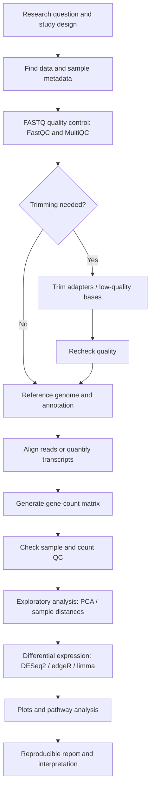

# Bioinformatics Learning Roadmap

**A free, practical path from Linux and programming to real bioinformatics projects and end-to-end RNA-seq analysis.**

This repository is designed for self-learners, biology students, programmers moving into computational biology, and researchers who want to analyse biological data independently. It starts at beginner level and moves toward reproducible bulk RNA-seq workflows, advanced transcriptomics, and optional single-cell analysis.

*Curated in October 2026. Course pages and software documentation can change over time.*

All core learning materials and software linked here are free to access. Most programming courses are video-based; official manuals and tutorials are included so you can practise, check details, and move beyond watching videos.

> **Learning rule:** Watch a lesson, reproduce it yourself, change something, and write down what you learned. Do not move to the next stage until you can repeat the key steps without copying every command.

## Contents

- [Roadmap at a glance](#roadmap-at-a-glance)
- [Stage 0 — Setup and study habits](#stage-0--setup-and-study-habits)
- [Stage 1 — Linux, Bash, and the command line](#stage-1--linux-bash-and-the-command-line)
- [Stage 2 — Git, environments, and notebooks](#stage-2--git-environments-and-notebooks)
- [Stage 3 — Python programming](#stage-3--python-programming)
- [Stage 4 — Python libraries for data science and bioinformatics](#stage-4--python-libraries-for-data-science-and-bioinformatics)
- [Stage 5 — R programming](#stage-5--r-programming)
- [Stage 6 — Statistics and experimental design](#stage-6--statistics-and-experimental-design)
- [Stage 7 — Biology and bioinformatics foundations](#stage-7--biology-and-bioinformatics-foundations)
- [Stage 8 — Biological databases and file formats](#stage-8--biological-databases-and-file-formats)
- [Stage 9 — RNA-seq: the step-by-step practical path](#stage-9--rna-seq-the-step-by-step-practical-path)
- [Stage 10 — Advanced RNA-seq and functional analysis](#stage-10--advanced-rna-seq-and-functional-analysis)
- [Stage 11 — Workflow automation and reproducibility](#stage-11--workflow-automation-and-reproducibility)
- [Stage 12 — Optional advanced track: single-cell RNA-seq](#stage-12--optional-advanced-track-single-cell-rna-seq)
- [Portfolio projects](#portfolio-projects)
- [Free datasets and practice platforms](#free-datasets-and-practice-platforms)
- [A final analysis checklist](#a-final-analysis-checklist)
- [How to contribute](#how-to-contribute)

---

## Roadmap at a glance

| Order | Learn | You are ready to move on when… |
|---|---|---|
| 0 | Set up your computer and workspace | You can save projects, install software, and keep files organized. |
| 1 | Linux and Bash | You can navigate folders, inspect files, and run simple shell commands. |
| 2 | Git, environments, and notebooks | You can save code history and recreate a working software environment. |
| 3 | Python | You can write functions, loops, and scripts that read and transform files. |
| 4 | Python libraries | You can work with tables, numerical arrays, plots, and biological sequences. |
| 5 | R | You can manipulate data, make plots, and run an R script from start to finish. |
| 6 | Statistics and experimental design | You understand replicates, uncertainty, hypothesis tests, and multiple testing. |
| 7 | Biology and bioinformatics | You understand genes, transcripts, sequencing reads, and common sequence-analysis tasks. |
| 8 | Databases and file formats | You can find a public dataset and recognize its metadata and file formats. |
| 9 | Bulk RNA-seq | You can follow a raw-reads-to-results workflow and explain every major output. |
| 10 | Advanced transcriptomics | You can handle more complex designs and interpret gene/pathway results responsibly. |
| 11 | Reproducible workflows | You can rerun an analysis and explain exactly how you generated the results. |
| 12 | Single-cell RNA-seq (optional) | You understand the main single-cell workflow and its differences from bulk RNA-seq. |

## Stage 0 — Setup and study habits

### Recommended setup

- **Linux:** a Linux computer or a Linux environment through [Windows Subsystem for Linux (WSL)](https://learn.microsoft.com/en-us/windows/wsl/install). macOS also provides a Unix-like terminal.
- **Editor:** [Visual Studio Code](https://code.visualstudio.com/) or [RStudio Desktop / Posit](https://posit.co/download/rstudio-desktop/).
- **Python:** install through [Miniforge](https://github.com/conda-forge/miniforge) or another Conda distribution; use separate environments for projects.
- **R:** install [R](https://cran.r-project.org/) and [RStudio Desktop](https://posit.co/download/rstudio-desktop/).
- **Notebooks:** [Jupyter](https://jupyter.org/) is useful for exploration, but keep reusable analysis steps in scripts or workflows too.

### Practice

Create a folder called `bioinformatics-learning`. Inside it, make separate folders for notes, exercises, datasets, scripts, and projects. Keep raw data separate from processed data and never overwrite raw sequencing files.

---

## Stage 1 — Linux, Bash, and the command line

The command line is used throughout sequencing analysis, from downloading datasets to running aligners and organizing thousands of output files.

### Video course / lectures

- [Linux command line and Bash learning playlist](https://www.youtube.com/playlist?list=PLtK75qxsQaMLZSo7KL-PmiRarU7hrpnwK)
- [Linux tutorials playlist from edureka!](https://www.youtube.com/playlist?list=PL9ooVrP1hQOH3SvcgkC4Qv2cyCebvs0Ik)
- [Introduction to Bash — EMBL-EBI training materials](https://www.ebi.ac.uk/training/materials/genome-bioinformatics-materials/introduction-bash/)

### Practise while watching

- [Software Carpentry: The Unix Shell](https://swcarpentry.github.io/shell-novice/) — exercises for navigation, files, pipes, loops, and scripts.
- [Data Carpentry: Genomics Workshop](https://datacarpentry.github.io/genomics-workshop/) — command-line skills applied to genomics data.

### Learn these commands

`pwd`, `ls`, `cd`, `mkdir`, `cp`, `mv`, `rm`, `cat`, `less`, `head`, `tail`, `wc`, `find`, `grep`, `cut`, `sort`, `uniq`, `awk`, `sed`, pipes (`|`), redirects (`>`, `>>`), variables, wildcards, permissions, and simple `for` loops.

**Mini-task:** Download a small text file, inspect it, count its rows, filter records by a word, and save the result to a new file. Repeat the task with a FASTA or FASTQ example later.

---

## Stage 2 — Git, environments, and notebooks

Reproducible analysis means being able to explain what you ran and repeat it later. Learn version control and environment management before starting a large project.

### Video learning

- [Git and GitHub — Kunal Kushwaha](https://www.youtube.com/watch?v=apGV9Kg7ics)
- [Jupyter Notebook introduction — Corey Schafer](https://www.youtube.com/watch?v=HW29067qVWk)

### Practice and references

- [Pro Git book](https://git-scm.com/book/en/v2)
- [GitHub Skills](https://skills.github.com/)
- [Conda user guide](https://docs.conda.io/projects/conda/en/latest/user-guide/)
- [Mamba documentation](https://mamba.readthedocs.io/en/latest/)
- [Jupyter documentation](https://docs.jupyter.org/en/latest/)

**Mini-task:** Put a Python script in a Git repository, commit a change, and write a short `README.md` describing how to run it. Create a separate Conda environment for the project.

---

## Stage 3 — Python programming

Python is useful for automating file handling, building analysis tools, using public biological databases, and working with scientific data. Complete one main course before jumping into libraries.

### Main video playlists

1. [Python Ultimate Course — Data with Baraa](https://www.youtube.com/playlist?list=PLNcg_FV9n7qZGfFl2ANI_zISzNp257Lwn)
2. [Python Tutorials — Corey Schafer](https://www.youtube.com/playlist?list=PL-osiE80TeTt2d9bfVyTiXJA-UTHn6WwU)
3. [Python for Everybody — full university course on YouTube](https://www.youtube.com/watch?v=8DvywoWv6fI)

The Data with Baraa course is the requested first stop. Corey Schafer is a useful follow-up for deeper explanations of functions, modules, errors, files, and practical Python patterns. Python for Everybody is an alternative structured course if you prefer a university-style introduction.

### Practice

- [Python official tutorial](https://docs.python.org/3/tutorial/)
- [Exercism Python track](https://exercism.org/tracks/python)
- [Python practice problems on Rosalind](https://rosalind.info/problems/locations/)

### Minimum skills before moving on

Variables and types, strings, lists, tuples, dictionaries, sets, conditions, loops, functions, modules, exceptions, file handling, comprehensions, basic classes, virtual environments, and reading/writing CSV and text files.

**Mini-task:** Write a script that reads a FASTA file, counts the sequences, reports sequence lengths and calculates GC percentage. Start with ordinary Python; repeat the task with Biopython in Stage 4.

---

## Stage 4 — Python libraries for data science and bioinformatics

**How to use this section:** The playlist or video is for watching; the practice link is where you should code and look up details. Work through the core libraries first. Some specialized bioinformatics packages have fragmented video coverage, so their documentation and examples are especially important. A dedicated, complete English playlist was not easy to verify for every niche package; where that applies, it is stated explicitly instead of pretending a playlist covers the subject in depth.

### A. Core scientific Python

| Library | Video playlist or course | Practice / reference | Practical goal |
|---|---|---|---|
| **NumPy** | [NumPy tutorial playlist](https://www.youtube.com/playlist?list=PLS1QulWo1RIYWmvS03CzXh1MTSN9dbTnR) | [NumPy learning resources](https://numpy.org/learn/) · [NumPy quickstart](https://numpy.org/doc/stable/user/quickstart.html) | Create arrays, index and reshape them, apply vectorized operations, handle missing values, and understand broadcasting. |
| **pandas** | [Pandas Tutorials — Corey Schafer](https://www.youtube.com/playlist?list=PL-osiE80TeTsWmV9i9c58mdDCSskIFdDS) | [pandas getting started](https://pandas.pydata.org/docs/getting_started/index.html) · [Kaggle Learn: Pandas](https://www.kaggle.com/learn/pandas) | Import tables, clean metadata, filter rows, group samples, join tables, and write tidy results. |
| **Matplotlib** | [Matplotlib Tutorials — Corey Schafer](https://www.youtube.com/playlist?list=PL-osiE80TeTvipOqomVEeZ1HRrcEvtZB_) | [Matplotlib tutorials](https://matplotlib.org/stable/tutorials/) | Create and customize line plots, histograms, scatterplots, axes, legends, and figure layouts. |
| **Seaborn** | [Seaborn video tutorial playlist](https://www.youtube.com/playlist?list=PLtPIclEQf-3cG31dxSMZ8KTcDG7zYng1j) · [Data Analysis with Python course playlist](https://www.youtube.com/playlist?list=PLMB3nZyO9MeZnqtPFrpGUTBYh_PdOYfRr) | [Seaborn tutorial](https://seaborn.pydata.org/tutorial.html) | Make distribution plots, box/violin plots, pair plots, heatmaps, and categorical comparisons. |
| **SciPy** | [SciPy tutorial playlist](https://www.youtube.com/playlist?list=PL43QIPG6eiKVTFhsjTG89L1kfU0hVq0br) | [SciPy lectures](https://lectures.scientific-python.org/) · [SciPy reference](https://docs.scipy.org/doc/scipy/) | Practise statistical distributions, hypothesis tests, distance calculations, optimization, and numerical routines. The videos are an introduction; use the lectures and API documentation for more advanced work. |
| **scikit-learn** | [Machine-learning video playlist with scikit-learn topics](https://www.youtube.com/playlist?list=PLZoTAELRMXVPBTrWtJkn3wWQxZkmTXGwe) | [scikit-learn tutorials](https://scikit-learn.org/stable/tutorial/index.html) | Learn preprocessing, train/test splitting, cross-validation, clustering, classification, and model evaluation. This is optional for basic bulk RNA-seq. |

For a single video-based data-analysis overview, use [Data Analysis with Python — freeCodeCamp.org](https://www.youtube.com/watch?v=r-uOLxNrNk8). It is a useful companion for NumPy, pandas, plotting, and exploratory data analysis, but it does not replace practice with each library's documentation.

### B. Libraries for biological data

| Library | Video playlist or lecture | Practice / reference | What to learn |
|---|---|---|---|
| **Biopython** | [Biopython tutorial playlist](https://www.youtube.com/playlist?list=PLhYDP66xNTKRdtUM8ekEmq1fC0mosXrgn) · [12 Days of Biopython](https://www.youtube.com/playlist?list=PLhYDP66xNTKSTP-A4R64uN-RBeR9uFUMN) | [Biopython Tutorial and Cookbook](https://biopython.org/DIST/docs/tutorial/Tutorial.html) | Parse FASTA/FASTQ, use sequence records, calculate sequence statistics, translate DNA, align sequences, and query NCBI resources. |
| **pysam** | [Python bioinformatics tutorials playlist](https://www.youtube.com/playlist?list=PL7bBZTVSZJp7PbCUz5zehJznnHcRxf4cM) — useful background, but no complete dedicated English pysam playlist was verified. | [pysam documentation](https://pysam.readthedocs.io/en/latest/) | Read and inspect SAM/BAM/CRAM files, examine alignments, access read flags and tags, and work with genomic coordinates. |
| **pybedtools** | [Python bioinformatics tutorials playlist](https://www.youtube.com/playlist?list=PL7bBZTVSZJp7PbCUz5zehJznnHcRxf4cM) — use alongside the documentation; no complete dedicated English pybedtools playlist was verified. | [pybedtools documentation](https://daler.github.io/pybedtools/) · [BEDTools documentation](https://bedtools.readthedocs.io/en/latest/) | Intersect genomic intervals, compare features, and work with BED/GFF/GTF-style data. |
| **Scanpy** | [Introduction to single-cell RNA-seq using Scanpy — playlist](https://www.youtube.com/playlist?list=PL4rcQcNPLZxWQQH7LlRBMkAo5NWuHX1e3) | [Scanpy tutorials](https://scanpy.readthedocs.io/en/stable/tutorials/index.html) | Load AnnData, filter cells, normalize counts, identify highly variable genes, reduce dimensions, cluster cells, and visualize results. Save this for the single-cell track. |

### C. More useful Python tools

- [Jupyter](https://docs.jupyter.org/en/latest/) — interactive analysis notebooks.
- [Requests](https://requests.readthedocs.io/en/latest/) — retrieve data from web APIs.
- [Statsmodels](https://www.statsmodels.org/stable/index.html) — statistical models and regression.
- [Plotly Python](https://plotly.com/python/) — interactive figures.
- [Polars](https://docs.pola.rs/) — an alternative for large tabular datasets; optional, not a prerequisite.

### Python practice sequence

1. Read a CSV file with pandas and summarize its columns.
2. Clean a sample metadata table and check for missing values or duplicated sample names.
3. Use NumPy to transform numerical arrays and compare vectorized code with a loop.
4. Make a histogram, scatterplot, boxplot, and heatmap with Matplotlib/Seaborn.
5. Parse FASTA/FASTQ with Biopython and report sequence lengths and GC percentages.
6. Inspect a small BAM file with pysam and find reads overlapping a genomic region.
7. Save scripts, figures, and a short description in Git.

---

## Stage 5 — R programming

R is a core language for bulk RNA-seq because many established statistical methods and Bioconductor packages are built around it.

### Video playlists

1. [R Programming Tutorial — ProgrammingKnowledge](https://www.youtube.com/playlist?list=PLu5N4RVDaHgULdWgtylPU3ZrqaSiRDfbt)
2. [R in English — introductory playlist](https://www.youtube.com/playlist?list=PLLa_h7BriLH1KYmdXaSIj_k-H3ItbhtPA)

### Learn in this order

| Step | Watch / study | Practice |
|---|---|---|
| 1. R basics | Complete one of the R playlists above. | [R for Data Science, 2e](https://r4ds.hadley.nz/) — objects, vectors, data frames, functions, and scripts. |
| 2. Data wrangling | [dplyr documentation](https://dplyr.tidyverse.org/) and its examples. | Import a sample sheet, filter rows, join tables, and group/summarize records. |
| 3. Visualization | [ggplot2 documentation](https://ggplot2.tidyverse.org/) | Recreate a histogram, scatterplot, boxplot, and PCA plot. |
| 4. Reproducible reports | [Quarto guide](https://quarto.org/docs/guide/) | Generate an HTML report containing code, plots, methods, and conclusions. |
| 5. Bioinformatics with R | [Bioconductor course materials](https://www.bioconductor.org/help/course-materials/) | Use `SummarizedExperiment`, gene annotation, and a real expression dataset. |

### R packages used in RNA-seq

- [DESeq2](https://bioconductor.org/packages/release/bioc/html/DESeq2.html) — differential expression using count data.
- [edgeR](https://bioconductor.org/packages/release/bioc/html/edgeR.html) — count-based differential expression.
- [limma](https://bioconductor.org/packages/release/bioc/html/limma.html) — linear models and limma-voom workflows.
- [tximport](https://bioconductor.org/packages/release/bioc/html/tximport.html) — imports transcript-level quantification for gene-level analysis.
- [pheatmap](https://cran.r-project.org/package=pheatmap) and [ComplexHeatmap](https://bioconductor.org/packages/release/bioc/html/ComplexHeatmap.html) — expression heatmaps.
- [clusterProfiler](https://bioconductor.org/packages/release/bioc/html/clusterProfiler.html) — functional enrichment and pathway analysis.
- [biomaRt](https://bioconductor.org/packages/release/bioc/html/biomaRt.html) — retrieve gene annotation and identifiers.

**Mini-task:** Import a gene-count matrix into R, join it to a sample metadata table, make a PCA or sample-distance plot, and export the figure.

---

## Stage 6 — Statistics and experimental design

RNA-seq results are only as reliable as the study design and statistical reasoning behind them. Learn the concepts below before interpreting differential-expression tables.

### Video learning

- [StatQuest with Josh Starmer — statistics and machine learning videos](https://www.youtube.com/@statquest/playlists)
- [P-values: what they are and how to interpret them — StatQuest](https://www.youtube.com/watch?v=vemZtEM63GY)
- [Principal Component Analysis (PCA) — StatQuest](https://www.youtube.com/watch?v=FgakZw6K1QQ)
- [DESeq2 design explained: interaction terms — Bioinformagician](https://www.youtube.com/watch?v=OPt51qc5YJ8)

### Concepts to cover

- Biological versus technical replicates.
- Independent and paired designs.
- Mean, variance, probability distributions, and sampling.
- Null hypotheses, p-values, confidence intervals, and effect sizes.
- Multiple testing, adjusted p-values, and false discovery rate (FDR).
- Log fold change and why statistical significance is not the same as biological importance.
- Confounding, batch effects, interaction terms, and the limits of PCA.

### Practice

- [StatQuest video library](https://statquest.org/video_index.html)
- [OpenIntro Statistics — free textbook](https://www.openintro.org/book/os/)
- [DESeq2 vignette: statistical model and design examples](https://bioconductor.org/packages/release/bioc/vignettes/DESeq2/inst/doc/DESeq2.html)

**Mini-task:** Write out the experimental design for a hypothetical control-versus-treatment RNA-seq study. List the biological replicates, response variable, main contrast, and any possible confounders before opening the software.

---

## Stage 7 — Biology and bioinformatics foundations

Learn enough molecular biology to understand what an analysis measures and what an output means. You do not need to memorize every detail of molecular biology, but you should understand the terms used throughout sequencing workflows.

### Resources

- [EMBL-EBI: introductory bioinformatics pathway](https://www.ebi.ac.uk/training/online/courses/introductory-bioinformatics-pathway/)
- [EMBL-EBI: Bioinformatics for the Terrified](https://www.ebi.ac.uk/training/online/courses/bioinformatics-terrified/)
- [EMBL-EBI: sequence analysis tools](https://www.ebi.ac.uk/training/online/courses/guide-to-sequence-analysis-tools/)
- [Rosalind — computational biology problems](https://rosalind.info/problems/locations/)
- [NCBI BLAST](https://blast.ncbi.nlm.nih.gov/Blast.cgi)

### Topics

DNA and RNA, transcription, genes and transcripts, exons and introns, the genetic code, genome assemblies, reference sequences, gene annotations, sequence similarity, alignments, gene expression, and the distinction between a gene, transcript, and protein.

**Practice task:** Solve several Rosalind problems on DNA, RNA, and sequence statistics, then compare your implementation with the provided problem examples.

---

## Stage 8 — Biological databases and file formats

A strong analysis begins with a correctly identified dataset, suitable metadata, and compatible reference files.

### Databases

- [NCBI Sequence Read Archive (SRA)](https://www.ncbi.nlm.nih.gov/sra) — raw sequencing reads.
- [NCBI Gene Expression Omnibus (GEO)](https://www.ncbi.nlm.nih.gov/geo/) — gene-expression experiments and processed data.
- [European Nucleotide Archive (ENA)](https://www.ebi.ac.uk/ena/browser/home) — sequence reads and metadata.
- [Ensembl](https://www.ensembl.org/) — genes, transcripts, and genome annotations.
- [GENCODE](https://www.gencodegenes.org/) — reference gene and transcript annotations.
- [Expression Atlas](https://www.ebi.ac.uk/gxa/home) — gene-expression data across experiments and conditions.

### File formats to recognize

| Format | What it contains |
|---|---|
| FASTA | Nucleotide or protein sequences. |
| FASTQ | Sequencing reads with per-base quality scores. |
| SAM / BAM / CRAM | Sequence alignments; BAM and CRAM are binary formats. |
| BED | Genomic intervals. |
| GTF / GFF | Genomic feature and gene/transcript annotation. |
| CSV / TSV | Sample metadata, gene counts, and analysis results. |
| Matrix Market / H5AD | Matrix and annotated data structures used in some single-cell workflows. |

**Important:** Keep the genome build and annotation version consistent. Mixing a count matrix from one annotation with gene identifiers from another can create missing or incorrect matches.

---

## Stage 9 — RNA-seq: the step-by-step practical path

This is the main hands-on pathway. Follow the stages in order. Each stage has a **Watch** resource and a **Practice** resource. Some official Galaxy lessons include video recordings on the lesson page as well as step-by-step exercises.

### Recommended main course

- **Watch the end-to-end walkthrough:** [Reference-based RNA-seq analysis — Galaxy Training Network video session](https://galaxyproject.org/events/gcc2021/training/science-track.html) (look for the *Transcriptomics* section and the *Reference-based RNA-seq Analysis* session).
- **Practice the current tutorial:** [Galaxy Training Network — reference-based RNA-seq analysis](https://training.galaxyproject.org/training-material/topics/transcriptomics/tutorials/ref-based/tutorial.html).
- **Alternative browser-based course:** [Galaxy transcriptomics tutorials](https://training.galaxyproject.org/training-material/topics/transcriptomics/).
- **Terminal-based companion series:** [RNA-seq workflow — Bioinformatics With BB, Part 1](https://www.youtube.com/watch?v=dq31baC_AHs), [Part 2: QC, alignment, and quantification](https://www.youtube.com/watch?v=4y2R2PgdBHo), and [Part 3: DESeq2 and visualization](https://www.youtube.com/watch?v=DxesV0eWtTQ). Use the code/scripts linked in the video descriptions when available.
- **Extra stepwise video series:** [RNA-seq analysis with STAR and downstream exploration — Sanbomics playlist](https://www.youtube.com/watch?v=oRC406tbB8w&list=PLi1VnGoeDGjvHvl83QySD2oAQYFHPRYso).

> Start with the Galaxy workflow if you have never analysed RNA-seq before. It provides guided, hands-on steps without requiring you to install every tool. Then repeat key steps on the command line and in R.

### Step 1 — Understand the experiment and study metadata

Before running tools, understand what the samples represent and which comparison answers the research question.

- **Watch:** [RNA-seq differential-expression project — OMGenomics](https://www.youtube.com/watch?v=NGbZmlGLG5w). The opening section shows where to obtain a published dataset and how to prepare it for analysis.
- **Practice:** [NCBI GEO](https://www.ncbi.nlm.nih.gov/geo/), [SRA](https://www.ncbi.nlm.nih.gov/sra), and the [Galaxy reference-based RNA-seq tutorial](https://training.galaxyproject.org/training-material/topics/transcriptomics/tutorials/ref-based/tutorial.html).
- **Do:** Find a study with a clearly described control/treatment or condition comparison. Record accession, organism, tissue/cell type, sample names, condition, replicate, sequencing layout, and relevant covariates.
- **Move on when:** You can explain the biological question and identify independent biological replicates.

### Step 2 — Inspect raw FASTQ files with FastQC

Quality control helps reveal adapter contamination, quality drops, unexpected GC content, overrepresented sequences, and other issues before downstream analysis.

- **Watch:** [FastQC tutorial — installation and use on Linux](https://www.youtube.com/watch?v=5nth7o_-f0Q) by Bioinformatics Coach.
- **Practice:** [Galaxy: RNA-seq reads to counts](https://training.galaxyproject.org/training-material/topics/transcriptomics/tutorials/rna-seq-reads-to-counts/tutorial.html) or the [Bioinformatics Workbook RNA-seq tutorial](https://bioinformaticsworkbook.org/dataAnalysis/RNA-Seq/RNA-SeqIntro/RNAseq-using-a-genome.html).
- **Do:** Open the FastQC HTML report for every sample and write a short note on any failed or concerning modules. A warning is a prompt to investigate, not automatic proof that the data must be discarded.
- **Move on when:** You can explain the main FastQC plots and compare QC across samples.

### Step 3 — Summarize quality across samples and trim if needed

MultiQC combines reports from many samples. Trimming should be based on evidence and library preparation, not performed automatically without checking the data.

- **Watch:** [Cutadapt read-trimming tutorial](https://www.youtube.com/watch?v=_9NH60XTJjI).
- **Practice:** [Galaxy: RNA-seq reads to counts](https://training.galaxyproject.org/training-material/topics/transcriptomics/tutorials/rna-seq-reads-to-counts/tutorial.html) — includes raw QC, trimming, and QC after trimming; see also [MultiQC documentation](https://docs.seqera.io/multiqc/).
- **Tools to know:** [Cutadapt](https://cutadapt.readthedocs.io/en/stable/), [Trim Galore](https://www.bioinformatics.babraham.ac.uk/projects/trim_galore/), and [fastp](https://github.com/OpenGene/fastp).
- **Do:** Generate a MultiQC report. If trimming is justified, rerun FastQC and compare the reports before and after trimming.
- **Move on when:** You can justify whether trimming was needed and explain what changed.

### Step 4 — Choose a reference genome and annotation

Alignment and count results depend on the genome build and gene annotation. Confirm that the reference files match the organism and study.

- **Watch:** [RNA-seq Part 2 — QC, alignment, and quantification](https://www.youtube.com/watch?v=4y2R2PgdBHo), which demonstrates the command-line workflow, including alignment and quantification.
- **Practice:** [Ensembl](https://www.ensembl.org/), [GENCODE](https://www.gencodegenes.org/), and the [Galaxy reference-based RNA-seq tutorial](https://training.galaxyproject.org/training-material/topics/transcriptomics/tutorials/ref-based/tutorial.html).
- **Do:** Download or select matching genome FASTA and annotation GTF/GFF files. Record the genome build, annotation release, and whether the library is stranded.
- **Move on when:** You can explain which reference files your analysis uses and why.

### Step 5 — Align reads or quantify transcripts

There are two common approaches. Genome alignment uses tools such as STAR or HISAT2 and is often followed by gene-level read counting. Transcript quantifiers such as Salmon or kallisto estimate transcript abundance with a lighter-weight mapping strategy.

- **Watch — alignment:** [HISAT2 RNA-seq alignment walkthrough](https://www.youtube.com/watch?v=C_IuMW0hzCQ).
- **Watch — alignment and counting:** [RNA-seq from FASTQ to read counts with featureCounts](https://www.youtube.com/watch?v=mySdTJnbu9I) by Bioinformatics Coach.
- **Practice:** [Galaxy: RNA-seq reads to counts](https://training.galaxyproject.org/training-material/topics/transcriptomics/tutorials/rna-seq-reads-to-counts/tutorial.html).
- **Tool references:** [STAR](https://github.com/alexdobin/STAR), [HISAT2](https://daehwankimlab.github.io/hisat2/), [SAMtools](https://www.htslib.org/), [featureCounts / Subread](https://subread.sourceforge.net/), [Salmon](https://salmon.readthedocs.io/en/latest/), and [kallisto](https://pachterlab.github.io/kallisto/).
- **Do:** Follow one workflow from the start to the count matrix. Do not mix tools blindly: understand which input and output file each step expects.
- **Move on when:** You can identify the alignment or quantification output and describe how gene counts are obtained.

### Step 6 — Review mapping and count-matrix quality

A successful command does not guarantee useful data. Inspect mapping rates, sample-level read counts, gene-body coverage, strandedness, and unexpected sample differences.

- **Watch:** Continue the [FASTQ-to-counts walkthrough](https://www.youtube.com/watch?v=mySdTJnbu9I); it demonstrates mapping and featureCounts.
- **Practice:** [Galaxy: RNA-seq reads to counts](https://training.galaxyproject.org/training-material/topics/transcriptomics/tutorials/rna-seq-reads-to-counts/tutorial.html), including its QC-summary section.
- **Do:** Create a sample-level QC summary and check for missing samples, repeated sample IDs, unexpectedly low counts, and annotation mismatches.
- **Move on when:** You have a count matrix and metadata table whose sample names match exactly.

### Step 7 — Explore samples before testing genes

Exploratory data analysis can reveal mislabeled samples, outliers, unexpected clustering, and batch effects before differential-expression testing.

- **Watch:** [RNA-seq differential-expression project — OMGenomics](https://www.youtube.com/watch?v=NGbZmlGLG5w), which demonstrates result inspection and plots; pair it with the PCA concepts in [StatQuest PCA](https://www.youtube.com/watch?v=FgakZw6K1QQ).
- **Practice:** [Bioconductor RNA-seq workflow](https://bioconductor.org/packages/release/workflows/vignettes/rnaseqGene/inst/doc/rnaseqGene.html).
- **Do:** Plot library sizes, sample distances, and PCA. Investigate clusters or outliers rather than removing samples just because they differ.
- **Move on when:** You can explain the main sample patterns in terms of biology, technical variation, or uncertainty.

### Step 8 — Differential expression with DESeq2

DESeq2 models count data and estimates changes in gene expression between conditions. A standard analysis uses raw gene counts or appropriately imported estimated counts, along with a correct sample design.

- **Watch:** [RNA-seq tutorial with DESeq2 — OMGenomics](https://www.youtube.com/watch?v=NGbZmlGLG5w).
- **Practice:** [Official DESeq2 vignette](https://bioconductor.org/packages/release/bioc/vignettes/DESeq2/inst/doc/DESeq2.html) and [Bioconductor RNA-seq workflow](https://bioconductor.org/packages/release/workflows/vignettes/rnaseqGene/inst/doc/rnaseqGene.html).
- **Do:** Fit the planned comparison, inspect the results table, sort by adjusted p-value, and keep both effect size and uncertainty in view.
- **Move on when:** You can explain the contrast, log2 fold change, p-value, adjusted p-value, and why multiple-testing correction matters.

### Step 9 — Understand design formulas and complex experiments

Once a two-group comparison makes sense, learn paired designs, batch variables, multiple factors, and interactions. Use a design that reflects the experiment rather than the one that produces the most significant results.

- **Watch:** [DESeq2 interaction terms explained — Bioinformagician](https://www.youtube.com/watch?v=OPt51qc5YJ8).
- **Practice:** The [DESeq2 vignette](https://bioconductor.org/packages/release/bioc/vignettes/DESeq2/inst/doc/DESeq2.html), especially its sections on multi-factor designs and interactions.
- **Do:** Write the design formula in plain language first. Check whether biological condition is confounded with batch or another factor.
- **Move on when:** You can explain what each term in the design formula represents and which contrast answers the question.

### Step 10 — Make and interpret result plots

Plots help communicate effect sizes, sample structure, and groups of genes with similar expression patterns. Each plot answers a different question.

- **Watch:** [RNA-seq DESeq2 project — OMGenomics](https://www.youtube.com/watch?v=NGbZmlGLG5w) for MA and volcano plots; then use [Bioconductor's RNA-seq workflow](https://bioconductor.org/packages/release/workflows/vignettes/rnaseqGene/inst/doc/rnaseqGene.html) for additional exploratory visualizations.
- **Practice:** [ComplexHeatmap book](https://jokergoo.github.io/ComplexHeatmap-reference/book/) or the [pheatmap package](https://cran.r-project.org/package=pheatmap).
- **Do:** Make a PCA plot, MA plot, volcano plot, and heatmap. State whether values are raw counts, normalized counts, or transformed values.
- **Move on when:** Every figure has a clear purpose, readable labels, and a correct explanation of the data being plotted.

### Step 11 — Interpret gene lists and pathways

Differential-expression tables describe individual genes. Enrichment analysis helps ask whether a set of genes points toward shared biological functions or pathways.

- **Watch:** [Gene set enrichment analysis (GSEA) tutorial](https://www.youtube.com/watch?v=KY6SS4vRchY) by Genomics Gurus. For a second R-based example, see [GSEA for RNA-seq beginners](https://www.youtube.com/watch?v=WQTzsmLy0D8).
- **Practice:** [clusterProfiler book](https://yulab-smu.top/biomedical-knowledge-mining-book/), [g:Profiler](https://biit.cs.ut.ee/gprofiler/gost/), and [GSEA / MSigDB](https://www.gsea-msigdb.org/gsea/index.jsp).
- **Do:** Record the gene identifier type, background gene set, enrichment method, database/version, and multiple-testing adjustment. Read the leading genes behind an enriched pathway.
- **Move on when:** You can explain the difference between over-representation analysis and ranked-list gene-set enrichment.

### Step 12 — Write a reproducible report

Turn the analysis into something another person can inspect and repeat.

- **Watch:** Use the [Bioinformatics With BB three-part RNA-seq series](https://www.youtube.com/watch?v=dq31baC_AHs) as a workflow review and the [OMGenomics DESeq2 project](https://www.youtube.com/watch?v=NGbZmlGLG5w) as a compact reproducible-analysis example.
- **Practice:** [Quarto guide](https://quarto.org/docs/guide/), [GitHub Skills](https://skills.github.com/), and [nf-core/rnaseq documentation](https://nf-co.re/rnaseq/latest/).
- **Do:** Write down dataset accessions, sample metadata, reference genome and annotation versions, software versions, important parameters, exclusions, statistical model, and limitations. Include figures and key result tables.
- **Move on when:** Another person can understand what you did and reproduce the main output from your documented inputs and commands.

### The bulk RNA-seq workflow in one view

**A key statistical note:** Do not use TPM values as though they were raw counts for a standard DESeq2 differential-expression test. Follow the selected workflow's recommended input format.

---

## Stage 10 — Advanced RNA-seq and functional analysis

Take these topics one at a time after completing the core workflow. Not every project needs every method.

| Topic | Video / learning resource | Practice reference |
|---|---|---|
| Advanced DESeq2 designs | [Interaction terms in DESeq2](https://www.youtube.com/watch?v=OPt51qc5YJ8) | [DESeq2 vignette](https://bioconductor.org/packages/release/bioc/vignettes/DESeq2/inst/doc/DESeq2.html) |
| Alternative differential-expression approach | [RNAseq123 workflow](https://www.bioconductor.org/packages/release/workflows/html/RNAseq123.html) | [edgeR](https://bioconductor.org/packages/release/bioc/html/edgeR.html) and [limma](https://bioconductor.org/packages/release/bioc/html/limma.html) |
| Transcript-level quantification | [Salmon documentation](https://salmon.readthedocs.io/en/latest/) | [tximport vignette](https://bioconductor.org/packages/release/bioc/vignettes/tximport/inst/doc/tximport.html) |
| Differential exon usage | [DEXSeq documentation](https://bioconductor.org/packages/release/bioc/html/DEXSeq.html) | [DEXSeq package](https://bioconductor.org/packages/release/bioc/html/DEXSeq.html) |
| Gene Ontology and pathway enrichment | [GSEA tutorial video](https://www.youtube.com/watch?v=KY6SS4vRchY) | [clusterProfiler book](https://yulab-smu.top/biomedical-knowledge-mining-book/) |
| Gene-set enrichment from ranked lists | [GSEA for RNA-seq beginners](https://www.youtube.com/watch?v=WQTzsmLy0D8) | [GSEA and MSigDB](https://www.gsea-msigdb.org/gsea/index.jsp) |
| Publication-quality heatmaps | [ComplexHeatmap reference book](https://jokergoo.github.io/ComplexHeatmap-reference/book/) | [ComplexHeatmap Bioconductor page](https://bioconductor.org/packages/release/bioc/html/ComplexHeatmap.html) |
| Gene identifiers and annotation | [biomaRt documentation](https://bioconductor.org/packages/release/bioc/html/biomaRt.html) | [Ensembl](https://www.ensembl.org/) and [GENCODE](https://www.gencodegenes.org/) |

### Advanced questions to practise

- How should a paired experiment be modelled?
- What happens when batch and treatment are confounded?
- When is an interaction term needed?
- How do gene-level and transcript-level results differ?
- Which genes make the largest contribution to a pathway result?
- What is the effect of changing the reference genome, annotation, or gene identifier mapping?
- How do you report uncertainty and avoid overstating enrichment results?

---

## Stage 11 — Workflow automation and reproducibility

After you know what each tool does, learn to automate the steps so the same analysis can be run on another dataset or computer.

### Learn

- [Snakemake tutorial](https://snakemake.org/snakemake-tutorial) — rule-based workflow automation.
- [Nextflow training](https://training.nextflow.io/) — pipeline design and execution.
- [nf-core/rnaseq](https://nf-co.re/rnaseq/latest/) — a maintained community RNA-seq pipeline.
- [nf-core/rnaseq usage guide](https://nf-co.re/rnaseq/latest/docs/usage/) — samplesheets, parameters, profiles, and outputs.
- [Docker getting started](https://docs.docker.com/get-started/) — containers and consistent software environments.
- [Conda user guide](https://docs.conda.io/projects/conda/en/latest/user-guide/) — environment management.
- [Quarto](https://quarto.org/docs/guide/) — reports and reproducible scientific writing.

### A sensible learning order

1. Run every command in a small manual workflow and understand its inputs/outputs.
2. Put the commands into scripts with clear variables and filenames.
3. Use Git to track changes.
4. Learn either Snakemake or Nextflow first; do not try to master both at the same time.
5. Run a published workflow such as nf-core/rnaseq and read its configuration and reports.
6. Record versions, reference files, parameters, and how the workflow was invoked.

**Mini-task:** Rerun a small dataset with a documented workflow and confirm that the output files and key summary statistics are produced as expected.

---

## Stage 12 — Optional advanced track: single-cell RNA-seq

Single-cell RNA-seq has different data structures and quality-control decisions from bulk RNA-seq. Start this track after you understand expression matrices, basic statistics, and bulk RNA-seq outputs.

### Video learning

- [Introduction to single-cell RNA-seq using Scanpy — video playlist](https://www.youtube.com/playlist?list=PL4rcQcNPLZxWQQH7LlRBMkAo5NWuHX1e3)
- [Single-cell community tutorials playlist](https://www.youtube.com/playlist?list=PL4rcQcNPLZxWWCxOpQc5-8Yp0E9MCUHXD)

### Hands-on resources

- [Scanpy tutorials](https://scanpy.readthedocs.io/en/stable/tutorials/index.html)
- [Galaxy introduction to single-cell RNA-seq](https://training.galaxyproject.org/training-material/learning-pathways/intro_single_cell.html)
- [AnnData documentation](https://anndata.readthedocs.io/en/latest/)

### Learn in this order

1. Understand the cell-by-gene count matrix and AnnData object.
2. Perform cell and gene quality control.
3. Normalize data and identify highly variable genes.
4. Run PCA and neighborhood graph construction.
5. Use UMAP for visualization and cluster the cells.
6. Identify marker genes and annotate cell types carefully.
7. Compare cell populations across samples using methods that account for sample-level replication.
8. Explore integration, trajectory analysis, or RNA velocity only when your research question needs them.

---

## Portfolio projects

Use these projects to check whether you can apply the skills without following a tutorial line by line.

### Project 1 — Sequence analysis with Python

**Goal:** Write a reusable program that reads a FASTA file and reports sequence count, lengths, GC percentage, and summary statistics.

**Use:** Python, Biopython, Git, and [Rosalind problems](https://rosalind.info/problems/locations/).

**Deliverables:** Script, example input, output table, a few tests, and a short README.

### Project 2 — Reproduce a bulk RNA-seq comparison

**Goal:** Start from a public dataset or the supplied Galaxy tutorial dataset, run quality control, create a count matrix, explore samples, test differential expression, and interpret selected genes.

**Use:** [GEO](https://www.ncbi.nlm.nih.gov/geo/), [Galaxy transcriptomics tutorials](https://training.galaxyproject.org/training-material/topics/transcriptomics/), and [DESeq2](https://bioconductor.org/packages/release/bioc/vignettes/DESeq2/inst/doc/DESeq2.html).

**Deliverables:** Metadata sheet, QC summary, PCA plot, differential-expression table, volcano plot, heatmap, pathway summary, and methods report.

### Project 3 — Reproducible command-line RNA-seq pipeline

**Goal:** Repeat a small public study using command-line tools and a workflow manager.

**Use:** Linux, Conda/Mamba, FastQC/MultiQC, an alignment or quantification tool, a count-generation tool, R/DESeq2, and [Nextflow](https://training.nextflow.io/) or [Snakemake](https://snakemake.org/snakemake-tutorial).

**Deliverables:** Workflow code, configuration/sample sheet, software and reference versions, QC report, result files, and instructions for reproducing the run.

### Project 4 — Single-cell analysis (optional)

**Goal:** Follow a Scanpy tutorial on a public dataset and explain the main cell clusters and marker genes without claiming cell identities from a plot alone.

**Use:** [Scanpy tutorials](https://scanpy.readthedocs.io/en/stable/tutorials/index.html).

**Deliverables:** Notebook or script, quality-control summary, UMAP, marker-gene table, and a short discussion of limitations.

---

## Free datasets and practice platforms

- [Galaxy Training Network](https://training.galaxyproject.org/training-material/) — guided tutorials with supplied data and workflows.
- [NCBI GEO](https://www.ncbi.nlm.nih.gov/geo/) — expression studies and processed datasets.
- [NCBI SRA](https://www.ncbi.nlm.nih.gov/sra) — raw reads; large datasets can require substantial storage and compute.
- [European Nucleotide Archive](https://www.ebi.ac.uk/ena/browser/home) — reads and study metadata.
- [Expression Atlas](https://www.ebi.ac.uk/gxa/home) — expression studies and downloads.
- [Rosalind](https://rosalind.info/problems/locations/) — computational biology problems.
- [Kaggle Learn](https://www.kaggle.com/learn) — short, practical modules on Python and pandas.
- [Bioconductor workflows](https://www.bioconductor.org/help/workflows/) — code-based genomic analysis workflows.

**Tip:** Start with small tutorial datasets before downloading dozens of FASTQ files. Raw sequencing data can take many gigabytes and may not be suitable for a laptop.

---

## A final analysis checklist

Before sharing an RNA-seq result, check each item below.

- [ ] The biological question and contrast are clearly stated.
- [ ] The sample sheet matches the data files exactly.
- [ ] Biological replicates and possible confounders are understood.
- [ ] The genome build and gene annotation are compatible and recorded.
- [ ] Raw-read QC has been reviewed across every sample.
- [ ] Trimming decisions are justified and post-trimming QC was checked when relevant.
- [ ] Alignment/quantification and count-generation outputs have been inspected.
- [ ] Sample relationships and outliers were investigated before testing.
- [ ] The statistical design matches the experiment.
- [ ] Multiple-testing correction and effect sizes are reported.
- [ ] Plots have clear labels and state which expression values they show.
- [ ] Pathway analysis records the identifier type, background, database, and method.
- [ ] Software versions, parameters, reference files, and exclusions are documented.
- [ ] The analysis can be reproduced from the recorded instructions.
- [ ] Biological claims are supported by the data and are not overstated.

---

## How to contribute

Contributions that improve this roadmap are welcome. Please prefer resources that are free to access, taught in English, practical, and maintained by a credible educator, university, or open-source project.

When suggesting a resource, include:

1. The exact title and direct link.
2. The language of instruction.
3. The level it targets and any prerequisites.
4. The practical exercises, code, or datasets that go with it.
5. Whether it is a complete playlist/course or a standalone lecture.

If a link becomes unavailable, open an issue with the broken URL and a replacement. Please do not add duplicate courses just to make the list longer; clear learning order and usable practice matter more than link count.

---

## Final advice

Do not try to learn every tool at once. Finish one Python course, learn the core libraries by writing small programs, complete one R course, and then follow the Galaxy RNA-seq workflow from beginning to end. After that, repeat the analysis in R and on the command line. This gives you a working foundation for more advanced methods and helps you understand what a pipeline is doing rather than treating it as a black box.
